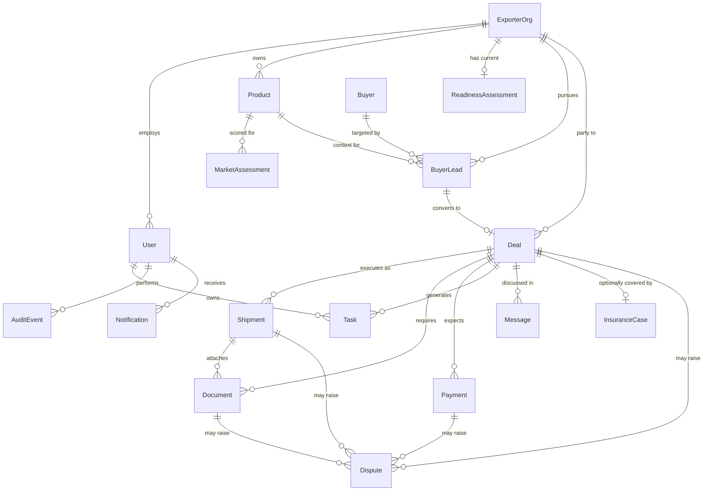

# 02 — Canonical Domain Model

Source: PRD Part 03 (Domain model). These are the shared objects **all three portals render**. UI
views may aggregate or filter them by role, but must never create role-specific duplicates of the
underlying record — see the non-negotiable rule in `AGENTS.md`.

---

## Entity map

| Entity | Core relationship | Why it exists |
|---|---|---|
| `User` | belongs to role(s), optionally an `ExporterOrg` | Identity and authorization actor |
| `ExporterOrg` | has `User`s, `Product`s, `Deal`s | Customer tenant / manufacturer organization |
| `Product` | belongs to `ExporterOrg`; feeds discovery/deals | Exportable SKU/category context: HS code, capacity, certifications |
| `ReadinessAssessment` | `ExporterOrg` + snapshot | Score, answers, blockers and enablement recommendations |
| `MarketAssessment` | `Product` + country + discovery run | Demand Discovery ranked result and rationale |
| `Buyer` | global/normalized buyer entity | Potential importer/company identity and evidence |
| `BuyerLead` | `ExporterOrg`/`Product` + `Buyer` | Pipeline relationship, outreach and lead state |
| `Deal` | `ExporterOrg` + `BuyerLead`; optional `Shipment`(s) | Commercial/execution source of truth |
| `Task` | linked to org/lead/deal/object | Action with owner, due date, SLA and state |
| `Document` | linked to deal/shipment; versioned | Generated/uploaded export document with approvals |
| `Shipment` | linked to deal | Route, CHA, freight and customs/logistics milestones |
| `Payment` | linked to deal/shipment | Commercial milestone, realization and proof/BRC visibility |
| `InsuranceCase` | linked to deal/shipment | Optional quote/policy/claim visibility |
| `Dispute` | linked to deal/shipment/payment/document | Exception resolution container |
| `Message` | threaded, deal/lead scoped, visibility aware | User↔agent communications, distinct from internal notes |
| `Notification` | user-targeted derived event | Actionable user alert with deep link |
| `AuditEvent` | actor + object + mutation | Immutable governance trail |

### Relationship overview

> **Note on completeness:** the source PRD gives full field dictionaries for the 12 entities below.
> `User`, `ReadinessAssessment`, `InsuranceCase`, and `Message` appear in the entity map above with
> only the short description shown — the source does not specify their fields in detail. Derive
> their schemas from the screens that reference them (readiness fields from EXP‑02/EXP‑03 in
> `docs/04-screens-exporter-portal.md`; insurance from EXP‑15; message threading from EXP‑16/AGT‑02/
> AGT‑04) rather than treating anything below as covering them.

---

## Field dictionaries

### ExporterOrg

| Field | Type | Requirement / semantics |
|---|---|---|
| `id` | UUID/string | Immutable primary identifier |
| `legal_name` | string | Required once compliance workflow begins |
| `display_name` | string | UI-friendly name |
| `gstin` | string | Optional until provided; validate format server-side |
| `iec` | string | Status-aware field: `unknown`/`not_started`/`pending`/`verified` |
| `country` / `state` / `city` | address fields | India-first; store structured values |
| `assigned_agent_id` | User ref | Current primary agent; assignment history retained |
| `readiness_status` | enum | `not_started` / `in_progress` / `ready` / `blocked` |
| `created_at` / `updated_at` | timestamp | ISO timestamps |

### Product

| Field | Type | Requirement / semantics |
|---|---|---|
| `id` | UUID/string | Stable product identifier |
| `exporter_org_id` | ref | Tenant owner |
| `name` | string | Required |
| `description` | text | Plain-language description |
| `hs_code` | string | AI-suggested / user-confirmed provenance should be stored |
| `capacity` | number + unit | Unit explicit |
| `moq` | number + unit | Optional |
| `price_target` | money | Currency required |
| `certifications` | array/refs | Each has status/evidence |
| `packaging` | structured/text | Reusable on repeat shipments |

### MarketAssessment

| Field | Type | Requirement / semantics |
|---|---|---|
| `id` | UUID/string | Result record |
| `run_id` | ref | Groups one discovery run |
| `country_code` | ISO code | Country identity |
| `overall_score` | 0–100 | Ranking score returned by engine |
| `demand_score` / `growth_score` / `competition_score` | numeric | Subscores, if engine supports |
| `india_share` | percent | Display source/date if available |
| `tariff_summary` | structured/text | Surface with caveat/source |
| `certification_requirements` | array | Required/likely; source/date |
| `logistics_summary` | structured/text | Route/cost/time summary where available |
| `price_band` | money range | Currency explicit |
| `rationale` | text | Explain why the market ranks as it does |
| `generated_at` | timestamp | Freshness indicator |

> **Implementation note (from source):** don't bind the frontend to an assumed AI provider or
> algorithm. The UI contract is a `DiscoveryRun` resource plus ranked `MarketAssessment` records.

### Buyer

| Field | Type | Requirement / semantics |
|---|---|---|
| `id` | UUID/string | Normalized buyer |
| `legal_name` / `display_name` | string | Company name |
| `country_code` | ISO code | Country |
| `website` | URL | Optional, validate |
| `buyer_type` | enum/string | Importer / distributor / retailer / etc. |
| `contacts` | array | Role-aware visibility; provenance/verification required |
| `source_evidence` | array | Where the buyer came from; dates |
| `import_activity_summary` | structured | Volume/recency/categories if available |
| `verification_status` | enum | `unverified` / `partially_verified` / `verified` |
| `risk_flags` | array | Never hide on the detail view |

### BuyerLead

| Field | Type | Requirement / semantics |
|---|---|---|
| `id` | UUID/string | Opportunity link |
| `exporter_org_id` / `product_id` / `buyer_id` | refs | Core relation |
| `stage` | enum | `new` / `shortlisted` / `contacted` / `replied` / `interested` / `negotiation` / `disqualified` / `converted` |
| `assigned_agent_id` | ref | Lead owner |
| `next_action` | text/ref | Human-readable task |
| `next_action_at` | timestamp | Due date |
| `last_contact_at` | timestamp | Recency |
| `interest_level` | enum | `unknown` / `low` / `medium` / `high` |
| `disqualification_reason` | enum + text | Required when disqualified |
| `deal_id` | ref | Set on conversion |

### Deal

| Field | Type | Requirement / semantics |
|---|---|---|
| `id` | UUID/string | Canonical deal |
| `exporter_org_id` / `buyer_id` / `buyer_lead_id` | refs | Identity |
| `stage` | enum | `qualifying` / `negotiating` / `terms_agreed` / `deal_locked` / `executing` / `shipped` / `closed_won` / `closed_lost` / `cancelled` |
| `value` | money | Currency required |
| `incoterm` | enum/string | Versioned/current standard label |
| `quantity` / `unit` | structured | Required before document generation as applicable |
| `unit_price` / `total` | money | Stored, not inferred by UI |
| `payment_terms` | structured/text | Approved terms |
| `delivery_terms` | structured/text | Dates/commitments |
| `risk_state` | enum | `normal` / `watch` / `at_risk` / `blocked` |
| `owner_agent_id` | ref | Agent owner |
| `quoted_fee_policy` | snapshot | Commercial fee history |
| `locked_at` | timestamp | When the deal becomes execution-ready |

### Task

| Field | Type | Requirement / semantics |
|---|---|---|
| `id` | UUID/string | Task identifier |
| `scope_type` / `scope_id` | polymorphic ref | Exporter / lead / deal / document / shipment |
| `title` | string | Action-oriented |
| `owner_user_id` / `owner_role` | ref/enum | Exactly one accountable owner |
| `state` | enum | `not_started` / `in_progress` / `waiting` / `done` / `cancelled` |
| `priority` | enum | `low` / `normal` / `high` / `urgent` |
| `due_at` | timestamp | Nullable only where policy allows |
| `sla_state` | derived enum | `on_time` / `due_soon` / `overdue` / `escalated` |
| `blocked_reason` | text | Required if waiting/blocking |
| `visibility` | enum | `exporter_visible` / `internal` |

### Document

| Field | Type | Requirement / semantics |
|---|---|---|
| `id` | UUID/string | Document identity across versions |
| `deal_id` / `shipment_id` | refs | Context |
| `doc_type` | enum | `PI` / `CI` / `packing_list` / `shipping_bill_draft` / `COO_draft` / `declaration` / `insurance_declaration` / etc. |
| `version` | integer/string | Monotonic version |
| `source` | enum | `generated` / `uploaded` / `imported` |
| `generation_status` | enum | `queued` / `processing` / `generated` / `failed` |
| `review_status` | enum | `not_reviewed` / `agent_reviewed` / `changes_requested` |
| `approval_status` | enum | `not_required` / `pending` / `exporter_approved` / `rejected` |
| `filing_status` | enum | `not_applicable` / `draft` / `ready` / `filed` / `accepted` / `rejected` |
| `file_ref` | secure object ref | Use signed download/preview URL |
| `checksum` | string | Optional integrity/version aid |
| `generated_from_snapshot` | ref/json | Inputs used; enables reproducibility |

> Generation, review, approval, and filing are **four independent state dimensions** — never
> collapse them into one status chip. See the Document lifecycle state machine in
> `docs/07-workflow-state-machines.md`.

### Shipment

| Field | Type | Requirement / semantics |
|---|---|---|
| `id` | UUID/string | Shipment record |
| `deal_id` | ref | Parent deal |
| `status` | enum | `planning` / `booking` / `pickup` / `customs` / `loaded` / `in_transit` / `arrived` / `delivered` / `exception` |
| `origin` / `destination` | structured | Location/port/ICD |
| `mode` | enum | `sea` / `air` / `courier` / `road` / `other` |
| `incoterm` | string | Snapshot from deal |
| `cha_partner_id` | ref | Assigned CHA |
| `freight_partner_id` | ref | Optional |
| `booking_ref` | string | External reference |
| `customs_ref` / `shipping_bill_no` | string | When available |
| `milestones` | array | Each with state/ETA/actual/evidence |
| `exception_state` | enum | `none` / `watch` / `blocked` |

### Payment

| Field | Type | Requirement / semantics |
|---|---|---|
| `id` | UUID/string | Payment visibility record |
| `deal_id` | ref | Parent |
| `amount` / `currency` | money | Expected amount |
| `payment_method` | enum/string | Advance / LC / collection / open account / etc. |
| `status` | enum | `not_due` / `due` / `partially_received` / `received` / `realized` / `overdue` / `disputed` |
| `due_at` | timestamp | Commercial due date |
| `received_at` / `realized_at` | timestamp | Milestones |
| `evidence_refs` | files | Remittance/bank proof as appropriate |
| `brc_status` | enum | `not_applicable` / `pending` / `available` / `verified` |
| `source` | enum | `exporter_update` / `AA` / `bank_partner` / `manual_ops` |

`brc_status` (Bank Realisation Certificate) is tracked **independently** from
`received`/`realized` payment status — see `docs/12-appendix-reference.md` glossary.

### Dispute

| Field | Type | Requirement / semantics |
|---|---|---|
| `id` | UUID/string | Case |
| `scope_type` / `scope_id` | ref | Deal / shipment / payment / document |
| `type` | enum | `payment` / `quality` / `logistics` / `document` / `LC` / `inspection` / `other` |
| `severity` | enum | `low` / `medium` / `high` / `critical` |
| `status` | enum | `open` / `investigating` / `waiting_external` / `proposed_resolution` / `resolved` / `closed` |
| `owner_user_id` | ref | Accountable case owner |
| `summary` | text | User-safe summary |
| `internal_notes` | separate records | Never expose by accident |
| `resolution` | text/structured | Final resolution and `accepted_at` |
| `sla_due_at` | timestamp | Escalation control |

### AuditEvent

| Field | Type | Requirement / semantics |
|---|---|---|
| `id` | UUID/string | Immutable |
| `actor_user_id` / `role` | refs | Who acted |
| `action` | string/enum | `create` / `update` / `approve` / `reassign` / etc. |
| `object_type` / `object_id` | ref | Affected object |
| `timestamp` | timestamp | Server authoritative |
| `before_summary` / `after_summary` | structured | Avoid unnecessary secret data |
| `correlation_id` | string | Trace across services/jobs |
| `source` | enum | `web` / `api` / `job` / `admin` |

### Notification (payload contract)

Given in full in the source (§7.1) rather than §3.2, included here for completeness alongside the
other entities:

| Field | Requirement |
|---|---|
| `id` | Stable notification ID |
| `user_id` | Target user |
| `type` | Machine-readable event type |
| `title` / `body` | Human-readable; no secrets |
| `severity` | `info` / `action_required` / `warning` / `critical` |
| `object_type` / `object_id` | Context target |
| `deep_link` | Role-valid route; server/API still authorizes |
| `read_at` | Nullable timestamp |
| `created_at` | Server timestamp |
| `dedupe_key` | Optional grouping/deduplication key |

Full notification catalog (who gets notified about what, and through which channel) is in
`docs/08-notifications-audit-analytics.md`.
