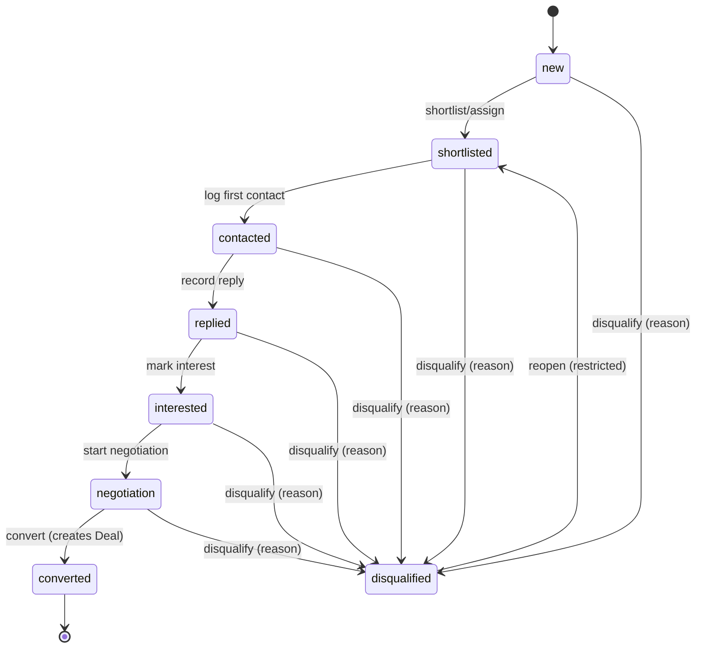
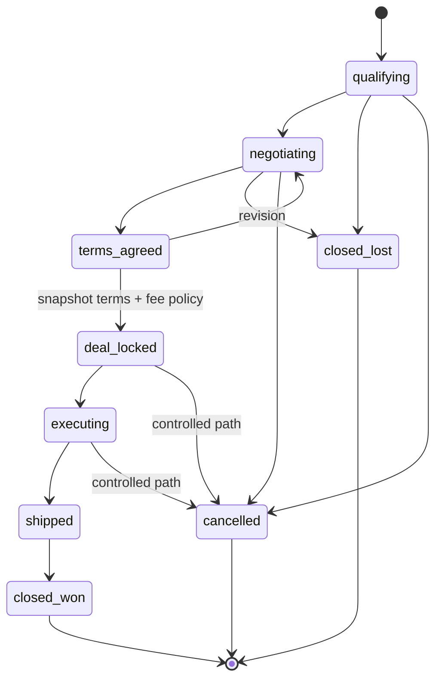
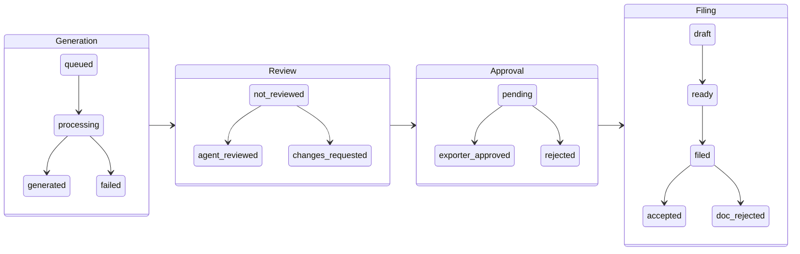
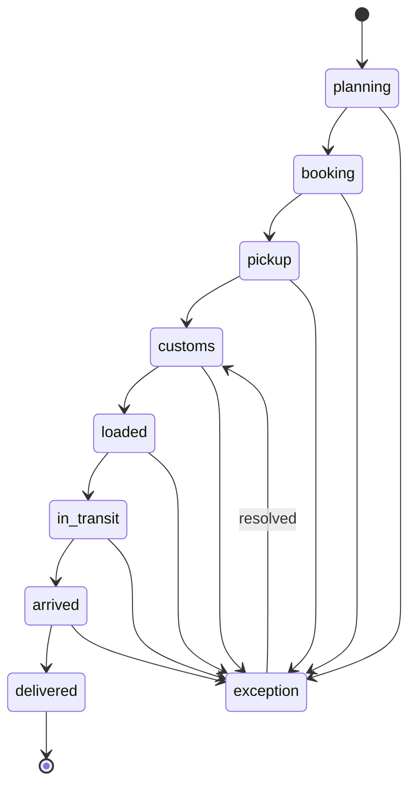
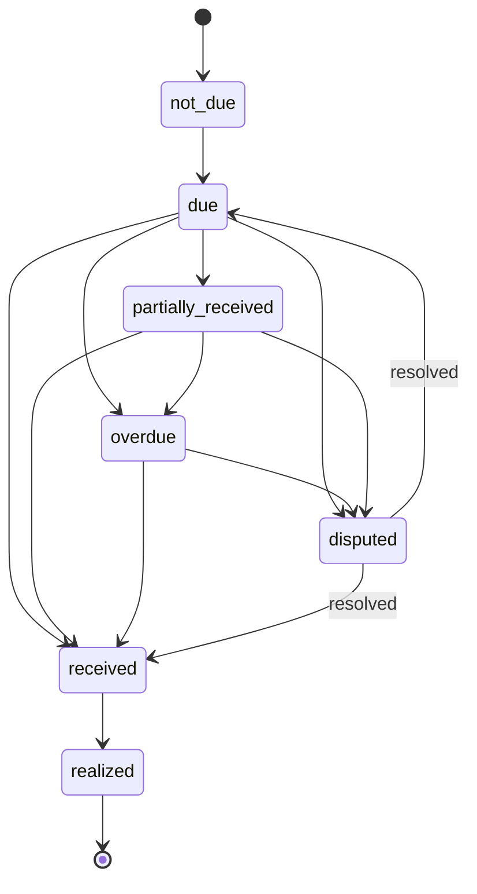
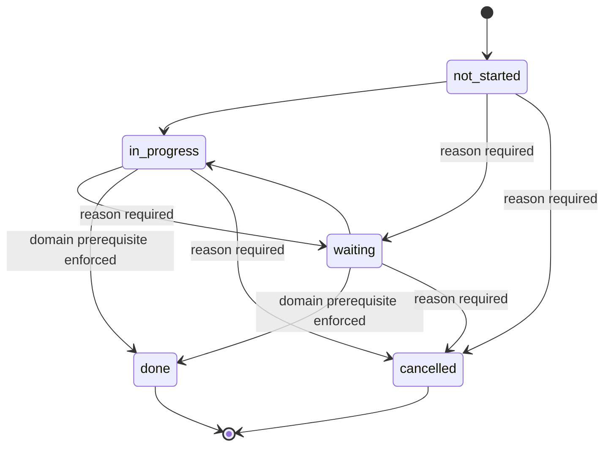
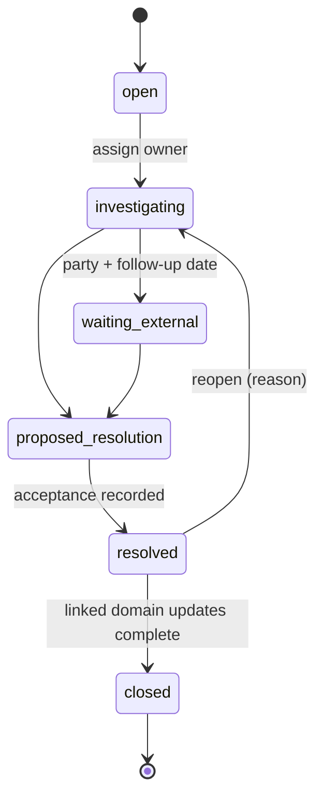

# 07 — Workflow State Machines

Source: PRD Part 06. These define **allowed transitions and required side effects**. This is
primarily a *backend* contract — the frontend renders state and offers transitions, but the server
validates every one of them.

**Universal rules:**

- A transition that fails its guard returns a structured error with blockers (see
  `PREREQUISITES_NOT_MET` in `docs/09-api-platform-contract.md`), not a silent no-op.
- Every material transition writes an `AuditEvent`.
- Reasons are mandatory wherever the tables below say so — enforce server-side, not just in the form.

---

## 7.1 Buyer Lead state machine

| From | Action | To | Required side effects / guards |
|---|---|---|---|
| `new` | Shortlist/assign | `shortlisted` | Owner assigned or queued; **no outreach yet** |
| `shortlisted` | Log first contact | `contacted` | `last_contact_at` set; next action required |
| `contacted` | Record reply | `replied` | Reply activity recorded; next action |
| `replied` | Mark interest | `interested` | Interest level/rationale; next action |
| `interested` | Start negotiation | `negotiation` | Create/link draft Deal as policy defines |
| `negotiation` | Convert | `converted` | Canonical Deal exists; **no duplicate** |
| Any active | Disqualify | `disqualified` | Reason required; close/cancel open outreach tasks |
| `disqualified` | Reopen | `shortlisted` or prior valid | Restricted/reasoned; audit |

---

## 7.2 Deal state machine

| State | Meaning | Allowed next | Guard / side effect |
|---|---|---|---|
| `qualifying` | Buyer opportunity exists; terms incomplete | `negotiating` / `closed_lost` / `cancelled` | Core buyer/exporter/product refs required |
| `negotiating` | Commercial proposal active | `terms_agreed` / `closed_lost` / `cancelled` | Versioned proposal |
| `terms_agreed` | Required commercial approvals achieved | `deal_locked` / `negotiating` | Accepted proposal version recorded |
| `deal_locked` | Execution authorized | `executing` / `cancelled` via controlled path | **Snapshot accepted terms + fee policy**; create required execution tasks/docs |
| `executing` | Docs/CHA/shipment prep in progress | `shipped` / `cancelled` / exception substate | Prerequisites controlled by document/shipment state |
| `shipped` | Shipment departed/recognized milestone | `closed_won` / payment pending | Shipment evidence/ref as policy |
| `closed_won` | Commercial/export lifecycle complete | repeat clone only | Payment/closure criteria as business policy |
| `closed_lost` | Opportunity lost | reopen restricted | Reason required |
| `cancelled` | Stopped | reopen restricted | Reason/actor required |

> **`deal_locked` is the most consequential transition in the product.** It must:
> 1. Verify all required approvals server-side (never trust the client),
> 2. Freeze a **Deal Snapshot** — buyer, SKU, quantity, price, Incoterm, payment terms, ship window,
>    special conditions — from which *all documents subsequently generate*,
> 3. Snapshot the fee policy in force at that moment,
> 4. Create the required execution tasks and document checklist,
> 5. Make commercial terms read-only except through an explicit amendment workflow.

---

## 7.3 Document lifecycle

Documents have **five independent dimensions**. Never collapse them into a single status field —
this is one of the most frequently violated rules in document-heavy products.

| Dimension | States | Important rule |
|---|---|---|
| **Generation** | `queued` → `processing` → `generated` \| `failed` | Independent from approval and filing |
| **Review** | `not_reviewed` → `agent_reviewed` \| `changes_requested` | A new version **resets** relevant review state |
| **Approval** | `pending` → `exporter_approved` \| `rejected`/`changes_requested` | Approval bound to **version/checksum** |
| **Filing** | `draft`/`not_applicable` → `ready` → `filed` → `accepted` \| `rejected` | External rejection **never deletes** the filed attempt |
| **Version** | v1 → v2 → v3… | Only one current version; historical immutable enough for audit |

**Document types and default owners (Blueprint):**

| Document | Default owner | Required state flow |
|---|---|---|
| Proforma Invoice | Agent + exporter | Generated → reviewed → exporter approved → sent |
| Commercial Invoice | Agent | Draft → approved → final |
| Packing List | Agent/exporter | Generated → quantity/weight verified |
| Shipping Bill draft | Agent + CHA | Draft → CHA review → filed → reference captured |
| Certificate of Origin draft | Agent | Draft → supporting docs → submitted/issued |
| Declarations / Insurance | Agent | Generated → applicability check → approved |

> **Critical pattern (Blueprint):** each document needs source data, an AI-generated badge, last
> editor, version number, a checklist of missing fields, approval buttons, and an audit trail.
> "Download PDF" alone is not enough.

---

## 7.4 Shipment lifecycle

| From | To | Minimum expected data / event |
|---|---|---|
| `planning` | `booking` | Mode + route/pickup data sufficient |
| `booking` | `pickup` | Booking/partner assignment confirmed |
| `pickup` | `customs` | Pickup actual + goods/evidence as needed |
| `customs` | `loaded` | Customs cleared / shipping refs as applicable |
| `loaded` | `in_transit` | Departure actual/ref |
| `in_transit` | `arrived` | Arrival actual/ETA |
| `arrived` | `delivered` | Delivery actual/proof as applicable |
| Any active | `exception` | Reason + owner + remediation task/case |
| `exception` | Prior/next valid | Resolution recorded; state transition explicit |

Milestones must distinguish **ETA vs. actual** timestamps (EXP-14-AC02).

---

## 7.5 Payment lifecycle

| State | Meaning | Transitions / rule |
|---|---|---|
| `not_due` | No expected payment due yet | → `due` when due condition/date reached |
| `due` | Expected and unpaid | → `partially_received` / `received` / `overdue` |
| `partially_received` | Some funds received | Outstanding amount visible; → `received`/`overdue` |
| `received` | Funds reported/confirmed received | → `realized` depending on bank/export process |
| `realized` | Export realization milestone complete | **BRC may still be pending/available independently** |
| `overdue` | Past due and outstanding | Risk + task/dispute path |
| `disputed` | Payment case open | Linked Dispute controls resolution; may return to `due`/`received`/etc. |

`brc_status` (`not_applicable` / `pending` / `available` / `verified`) is tracked **separately** and
must not be inferred from payment status (EXP-15-AC04).

**Provenance is mandatory:** every payment milestone carries a `source` — `exporter_update` / `AA` /
`bank_partner` / `manual_ops`. The Blueprint is explicit: *do not overpromise bank integrations* —
label each milestone with where the information came from.

---

## 7.6 Task lifecycle

| From | To | Rule |
|---|---|---|
| `not_started` | `in_progress` | Actor must own or have permission |
| `not_started` / `in_progress` | `waiting` | `waiting_reason` required; `waiting_on` and follow-up recommended |
| `waiting` | `in_progress` | Reason resolved/resumed |
| `in_progress` / `waiting` | `done` | Domain prerequisite enforced if the task represents an actual approval/upload/filing |
| Any active | `cancelled` | Reason required; **do not use cancel to hide failed work** |
| Overdue | escalated (SLA) | SLA is a derived/exception action, **not necessarily a task state** |

**SLA is a separate derived layer**, computed from `due_at`/`warning_at` + config:
`on_time` / `due_soon` / `overdue` / `escalated`. Never let a user edit it directly (AGT-07-AC03).

---

## 7.7 Dispute lifecycle

| From | To | Required data |
|---|---|---|
| `open` | `investigating` | Owner assigned, initial facts |
| `investigating` | `waiting_external` | Waiting party + follow-up date |
| `investigating` / `waiting_external` | `proposed_resolution` | Resolution proposal + impact |
| `proposed_resolution` | `resolved` | Acceptance/authority basis recorded |
| `resolved` | `closed` | Closure summary and linked domain updates complete |
| Any open | `open`/`investigating` | Reopen/escalate with reason; **preserve history** |

---

## Cross-machine dependencies

These state machines are **coupled**. The most important couplings to implement explicitly:

| Trigger | Downstream effect |
|---|---|
| `BuyerLead → converted` | Exactly one `Deal` created/linked; lead history retained |
| `Deal → deal_locked` | Terms + fee snapshot frozen; execution tasks + document checklist created; `Shipment` becomes available |
| Document `filing → rejected` | Remediation task created; deal `risk_state` raised; Ops exception queue entry; exporter gets a safe-language update |
| Shipment → `exception` | Deal risk banner visible to **all** roles; owner explicit; exporter sees the next step |
| Payment → `overdue` | Exporter reminder + agent task + Ops risk based on threshold; dispute path available |
| Task → `escalated` | Ops exception/escalation record; visible in OPS-03 |
| Dispute → `resolved`/`closed` | Linked financial/operational impact recorded; corresponding risk cleared only via explicit domain rule |

These are exactly the scenarios in the cross-portal integration test matrix — see
`docs/11-build-plan-qa-release.md`.
